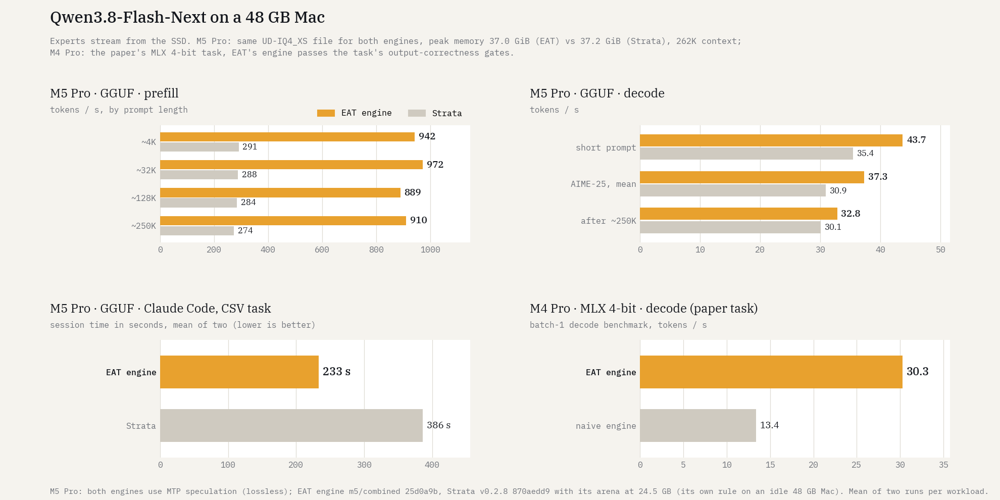
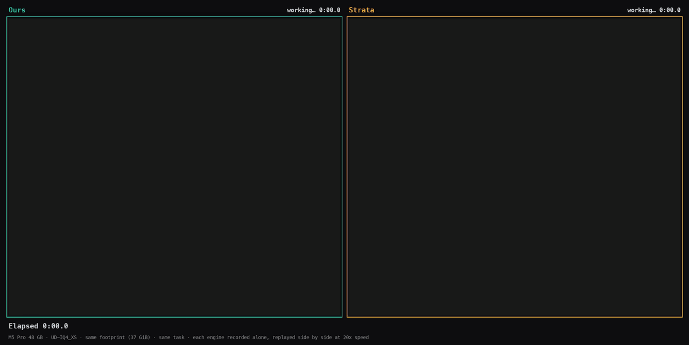
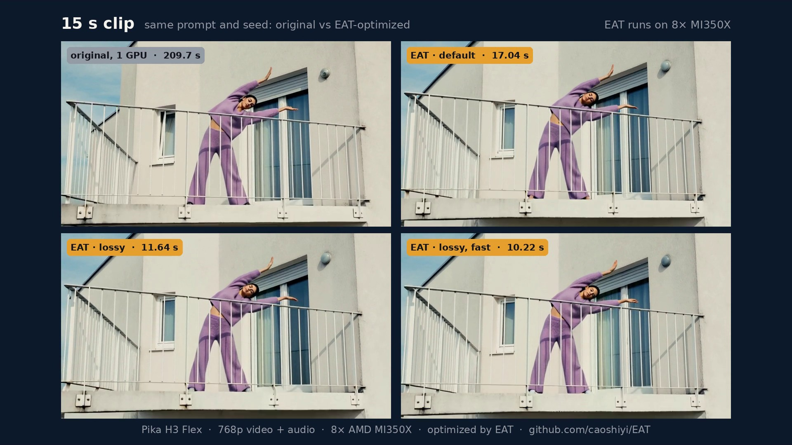

<p align="center">
  <picture>
    <source media="(prefers-color-scheme: dark)" srcset="assets/eat_lockup_dark.png">
    
  </picture>
</p>

<h3 align="center">Evolving Agent Teams</h3>
<p align="center"><em>Agents that diagnose why they stall and restructure their own team</em></p>

<p align="center">
  <a href="https://arxiv.org/abs/2610.36848"></a>
  <a href="https://huggingface.co/datasets/eva98/eat-gym"></a>
  <a href="https://huggingface.co/datasets/eva98/eat-evolution-traces"></a>
  <a href="https://github.com/caoshiyi/eat-kernels"></a>
  <a href="LICENSE"></a>
</p>

<p align="center"></p>

<p align="center"><b>One supervisor agent. No hand-written solution.</b> It designs a team of coding agents, watches it work,
diagnoses why it stalls, and rebuilds the team, for as long as the budget lasts.</p>

## Get started

In Claude Code, install EAT once:

```
/plugin install eat --marketplace caoshiyi/EAT
```

Then, in the repository you want to improve, just ask:

> *Use EAT to make `bench.py` faster on GPUs 0 and 1. Budget $200.*
>
> *Run the EAT Gym task `amd_kda_mi350x` on GPUs 0-3 with a $300 budget.*

Claude checks the machine, writes the task's eval and rules with you, records the starting score and launches the run;
later ask it how the run is going, or to pause, stop or resume it. **Nothing installed?** Tell Claude Code *"Use EAT
(github.com/caoshiyi/EAT) to ..."* and it fetches the skill itself.

## The supervisor invents the team that breaks the plateau

The supervisor never touches the solution. When the score stalls, it reads the team's transcripts, names what is
holding it back, and **creates the role that attacks it**. Over the 73 iterations of the MI350X run it used 42
distinct roles, from a single `solo_optimizer` to an `energy_auditor` and a `lander`:

<p align="center"></p>

**The B200 run passed the best published kernel in four iterations**, each one a team rebuilt around the
supervisor's diagnosis of the last:

<p align="center"></p>

The same pattern appears late in long runs. In the MI350X run, iterations 57 and 58 shipped nothing; the
supervisor found that the team had been timing its ideas in a different regime from the eval, and wrote a new role
for iteration 59:

> **ENERGY AUDITOR.** *"The pattern runs on a power transient: device time is 1.08–1.29× the gapped time ... The team
> has therefore been pricing levers in a regime the score does not use. Your job is to fix the measurement and re-open
> what it may have mis-judged."*

That iteration set a new best (2.90×), and the run went on to 3.03×. Every team config, prompt and transcript is in
the [traces](https://huggingface.co/datasets/eva98/eat-evolution-traces).

## Demos

### A robot policy written by agents

The starting policy is the Pi_05 VLA. The EAT team replaced it with Python code that calls the frozen Pi_05 and, at
runtime, Claude, and raised RoboDojo's leaderboard score from 11.4 to **62.1 on held-out seeds, above every entry on
the leaderboard (55.3, Oct 26, 2026)**. Same scene, left: Pi_05; right: the team's code policy
([eat-robodojo-policy](https://github.com/caoshiyi/eat-robodojo-policy)).

<p align="center"></p>
<p align="center"><sub><code>make_kong</code> (Mahjong): task score 16.7 → 97.2. <a href="assets/robodojo_make_kong.mp4">Full video</a></sub></p>

<table>
<tr>
<td width="50%"></td>
<td width="50%"></td>
</tr>
<tr>
<td align="center"><sub><code>arrange_largest_number</code>: task score 2.5 → 88.3</sub></td>
<td align="center"><sub><code>classify_objects_by_language</code>: task score 3.3 → 80.0</sub></td>
</tr>
</table>

### Qwen3.8-Flash-Next served from a 48 GB Mac

The model does not fit in the Mac's memory, so its experts stream from the SSD. An EAT team wrote the offload engine,
starting from a naive port.

- **Apple M5 Pro, 48 GB, GGUF UD-IQ4_XS**, against Strata on the same file at the same memory (peak 37.0 vs
  37.2 GiB, both with MTP speculation, 262K context), **while keeping the KV cache in bf16 where Strata quantizes it
  to int8**: prefill **~3.3× faster** at every prompt length from 4K to 250K
  tokens (e.g. **910 vs 274 tokens/s** at 250K), decode **1.22× faster** after a short prompt (**43.7 vs 35.4 tokens/s**)
  and **1.21×** on AIME-25 requests; after a 250K-token prompt, decode is close (32.8 vs 30.1 tokens/s).
- **Apple M4 Pro, 48 GB, MLX 4-bit** (the paper's task), against the naive engine: batch-1 decode
  **30.3 vs 13.4 tokens/s**, and recorded coding-agent sessions **3.32× faster**.

<p align="center"></p>

The same model driving Claude Code locally on the M5 Pro: each engine serves Claude Code v2.1.296, which adds CSV
import and export to a small invoice library and writes the tests. Both pass their tests; over two runs each, EAT's
engine takes **233 s** on average and Strata **386 s** (**1.66×**).

<p align="center"></p>
<p align="center"><sub>First run of each engine (3 min 29 s vs 5 min 49 s), each recorded alone and replayed side by side at 20× speed; the clock shows recorded time. <a href="assets/mac_m5_claude_code.mp4">Video</a></sub></p>

On the M4 Pro (GGUF, with the expert victim cache pinned and the host tier locked in memory, peak 44 GiB), the same
engine decodes at 34.7 tokens/s after a short prompt and 30.2 tokens/s after a 250K-token prompt, and prefills at
350–375 tokens/s from 4K to 250K tokens.

### Pika H3 Flex video generation on 8 AMD GPUs

[Pika H3 Flex](https://github.com/Pika-Labs/Pika-H3-Flex) generates 768p video with synchronized audio. Its released
code runs on one GPU. An EAT team ported it to 8 AMD MI350X GPUs. By default the port keeps the original's precision
and is checked step by step against it: a 5 / 10 / 15 s clip takes **3.3 / 8.7 / 17.0 s** instead of 46 / 113 / 210 s
on one GPU (**13× faster**). Two opt-in lossy settings use lower precision in later sampling steps and reach
**2.4 / 5.6 / 10.2 s (20×)**. The port is merged into Pika's
[`contrib/amd-mi350x`](https://github.com/Pika-Labs/Pika-H3-Flex/tree/contrib/amd-mi350x) branch.

<p align="center"></p>
<p align="center"><sub>A 15 s clip, same prompt and seed: the original on 1 GPU (top left) vs EAT's default and two lossy settings on 8× MI350X.</sub></p>

## What is released

- **Kernels**, packaged for inference engines (vLLM-style serving interface with paged state and prefix-cache
  checkpoints; MI350X 3.04× prefill and 1.69× decode, B200 2.57× on 26 serving workloads):
  [eat-kernels](https://github.com/caoshiyi/eat-kernels).
- **Pika H3 Flex on 8× AMD MI350X**, merged into Pika's
  [`contrib/amd-mi350x`](https://github.com/Pika-Labs/Pika-H3-Flex/tree/contrib/amd-mi350x) branch.
- **The RoboDojo policy**, with its eval fleet setup: [eat-robodojo-policy](https://github.com/caoshiyi/eat-robodojo-policy).
- **Every supervisor and agent transcript**, team config, note and per-iteration kernel or policy:
  [eva98/eat-evolution-traces](https://huggingface.co/datasets/eva98/eat-evolution-traces).
- **The tasks**, at the state each run started from: [EAT Gym](https://huggingface.co/datasets/eva98/eat-gym).

The Mac serving engine is not released yet: it is built on FreeToken-metal, which is not public; its code will
follow once FreeToken-metal is open-sourced.

## How it works

EAT is a harness in which a **supervisor** agent repeatedly designs, launches and revises a **team** of coding agents
(Claude Code) that optimize a GPU kernel (or another program, such as a robot policy) against a fixed eval. The
supervisor never writes the solution; its only output each iteration is a team configuration (roles, prompts, phases,
ownership of files and GPUs). The team does the work, the harness runs the official eval, and the supervisor reflects
on the result and evolves the team. A file system kept across all teams (learnings, evolution history, artifacts)
grounds each redesign in what earlier teams found.

<p align="center"></p>

```
while budget remains:
    supervisor:  REFLECT on the previous team's output -> EVOLVE roles / prompts / workflow -> emit TEAM_CONFIG
    harness:     launch the team's agents phase by phase -> run the official eval -> record cost and score
```

## Clean-room runs

To show that a result was not copied from code released after a cutoff, run the whole loop inside the
[bubblewrap](https://github.com/containers/bubblewrap) sandbox, from the task repository:

```bash
EAT_CLEAN=/path/to/sandbox-state EAT_ALLOWED_RO="/refs/cutlass /refs/flashinfer-2026-08-13" EAT_GPUS="0 1" \
CLAUDE_EXTRA_DISALLOWED=WebSearch,WebFetch $EAT_HOME/cleanroom/sandbox.sh \
    bash $EAT_HOME/agent_team/launch_stateless.sh --persistent 50 3 300
```

Only the task repository, EAT, and the `EAT_ALLOWED_RO` sources are visible, and the network reaches only the
Anthropic API (through `allowlist_proxy.py`, which logs every request). Afterwards,
`cleanroom/audit_clean_traces.py` scans every tool call in the run's transcripts for web use, network commands and
forbidden sources, and `cleanroom/audit_code_overlap.py` finds code lines that appear only in the forbidden sources.

## For coding agents

If a user asks you to use EAT and the `eat` skill is not installed: clone this repository (for example to
`~/.claude/skills/eat`) and follow [`SKILL.md`](SKILL.md), with `EAT_HOME` set to the clone.

## Citation

```bibtex
@inproceedings{cao2026eat,
  title     = {Evolving Agent Teams},
  author    = {Cao, Shiyi and Mao, Ziming and Li, Dacheng and Gonzalez, Joseph E. and Stoica, Ion},
  booktitle = {Advances in Neural Information Processing Systems (NeurIPS)},
  year      = {2026},
  url       = {https://arxiv.org/abs/2610.36848}
}
```

## License

Apache-2.0. Tasks installed from the EAT Gym bring their own NOTICE for the third-party code they contain.
